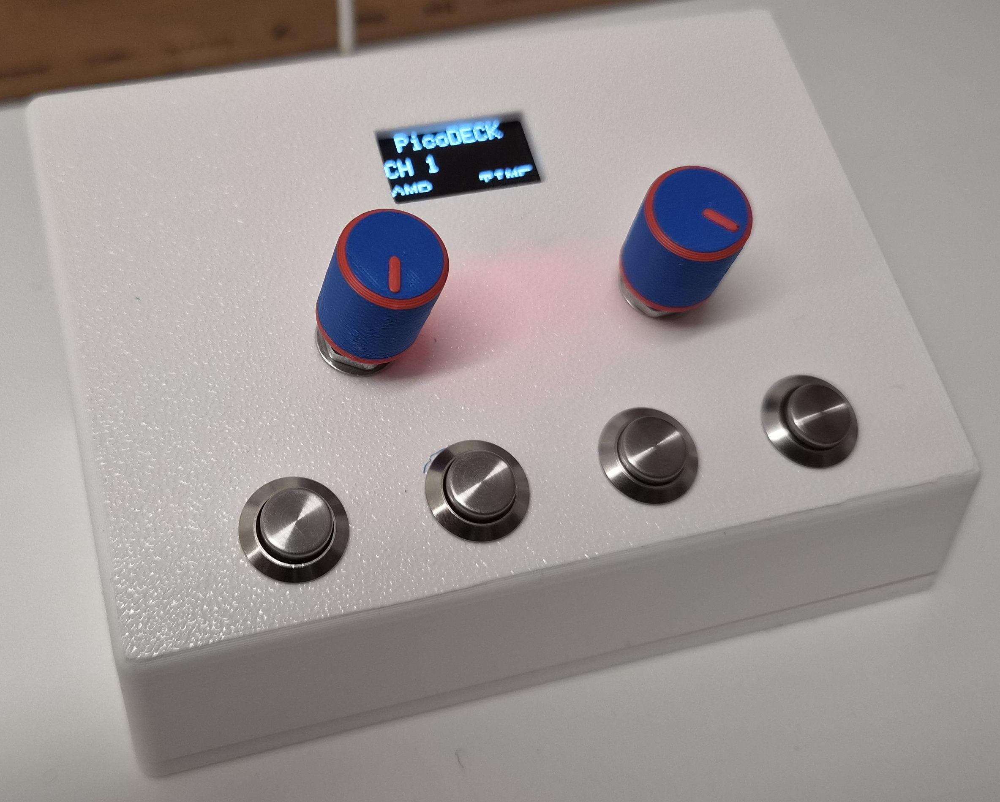
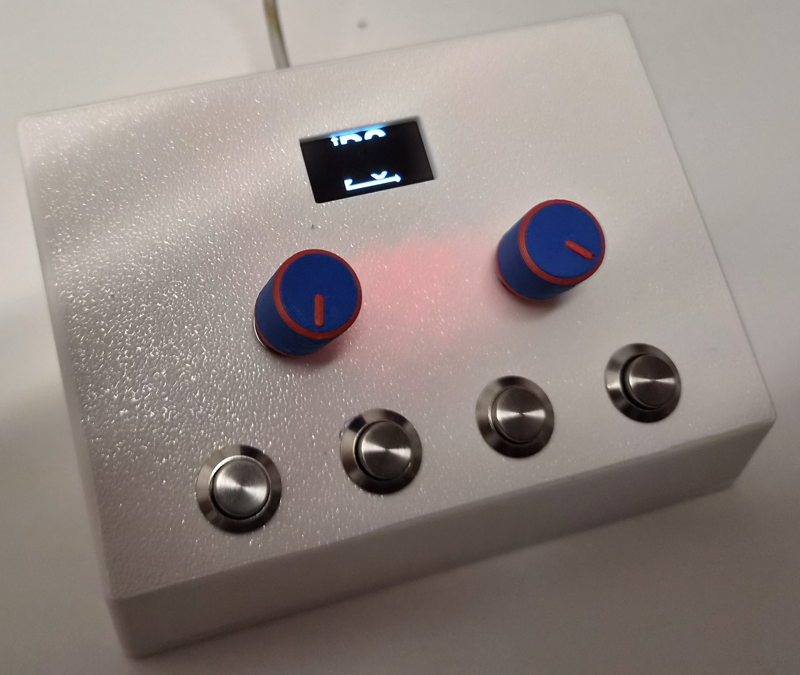

# PicoDeck User Manual



PicoDeck is a small control panel for **PicoScope 7**. It plugs into the PC
with a USB cable and behaves like a normal USB keyboard. Turning an encoder or
pressing a button types the keyboard shortcut PicoScope uses for that
function, so you can adjust the scope without the mouse. No driver and no PC
software are needed.

## Getting started

1. Connect PicoDeck to the PC with a USB cable (the USB-C opening is on the
   back wall).
2. Start PicoScope 7 and **click into the PicoScope window**. The deck types
   into whichever window has the keyboard focus, so PicoScope must be the
   active window.
3. After power-up the display shows the PicoScope 7 logo for about 2 seconds,
   then the main screen.



## Layout

```
  +--------------------------------------------+
  |        [ OLED 128x64  "PicoDECK" ]         |
  |    CH 1            AMP           TIME      |
  |                                            |
  |        (ENC1)                (ENC2)        |
  |                                            |
  |     (BTN1)   (BTN2)   (BTN3)    (BTN4)     |
  +--------------------------------------------+
```

- **Encoder 1** (left) adjusts the settings of the current channel.
- **Encoder 2** (right) adjusts time base, trigger level and pre-trigger.
- **Buttons 1-4** (bottom row) send single keys or switch the channel.

Each encoder can be turned and pressed like a button. Pressing it changes
what turning it does (see below).

## The display

The display always shows the current state of the deck:

| Position | Shows | Meaning |
|----------|-------|---------|
| Top, centered | `PicoDECK` | fixed title |
| Middle left | `CH 1` ... `CH 4` | the channel Encoder 1 currently controls |
| Bottom left | `AMP`, `OFF` or `FLT` | mode of Encoder 1 **on the current channel** |
| Bottom right | `TIME`, `TRIG` or `PRE` | mode of Encoder 2 |

The display updates immediately when you press an encoder or change the
channel.

## Buttons

A button sends its key when you **release** it.

| Button | Action |
|--------|--------|
| BTN1 | sends `Space` |
| BTN2 | sends `2` |
| BTN3 | **cycles the channel** CH 1 -> CH 2 -> CH 3 -> CH 4 -> CH 1 (sends no key) |
| BTN4 | sends `X` |

## Encoder 1 - channel settings

Encoder 1 works on the channel shown after `CH` on the display. Change the
channel with BTN3 first.

**Press the encoder** to switch its mode for the current channel:

`AMP` -> `OFF` -> `FLT` -> `AMP` ...

Each channel remembers its own mode, so CH 1 can be on `AMP` while CH 2 is on
`FLT`.

| Mode | Display | Turning the encoder |
|------|---------|---------------------|
| Amplitude | `AMP` | changes the channel's amplitude (vertical scale) |
| Offset | `OFF` | changes the channel's offset (vertical position) |
| Filter | `FLT` | changes the channel's filter setting |

The keys sent for each channel are:

| Channel | Clockwise / counter-clockwise key |
|---------|-----------------------------------|
| CH 1 | `Q` / `1` |
| CH 2 | `W` / `2` |
| CH 3 | `E` / `3` |
| CH 4 | `R` / `4` |

These keys are sent as they are in `AMP` mode, with `Shift` held in `OFF`
mode and with `Alt` held in `FLT` mode.

- In `OFF` mode the directions are swapped: clockwise sends the
  counter-clockwise key (with `Shift`) and vice versa.
- In `FLT` mode the same keys are sent with `Alt` held.
- Entering and leaving `FLT` sends `Alt` + `A` / `S` / `D` / `F` for channel
  1 / 2 / 3 / 4. This opens and closes the filter dialog of that channel in
  PicoScope.

## Encoder 2 - time base and trigger

Encoder 2 has one global mode. **Press the encoder** to cycle:

`TIME` -> `TRIG` -> `PRE` -> `TIME` ...

| Mode | Display | Clockwise | Counter-clockwise | Function |
|------|---------|-----------|-------------------|----------|
| Time base | `TIME` | `Up arrow` | `Down arrow` | time base |
| Trigger | `TRIG` | `B` | `V` | trigger level |
| Pre-trigger | `PRE` | `M` | `N` | pre-trigger amount |

## Quick reference

| Control | Action |
|---------|--------|
| BTN1 | `Space` |
| BTN2 | `2` |
| BTN3 | next channel |
| BTN4 | `X` |
| ENC1 press | `AMP` -> `OFF` -> `FLT` (current channel) |
| ENC1 turn | amplitude / offset / filter of the current channel |
| ENC2 press | `TIME` -> `TRIG` -> `PRE` |
| ENC2 turn | time base / trigger level / pre-trigger |

## Tips and troubleshooting

- **Nothing happens in PicoScope:** make sure the PicoScope window has the
  keyboard focus. The deck only types keys; it does not talk to PicoScope
  directly.
- **A function does the wrong thing:** PicoDeck assumes the default PicoScope
  7 shortcuts. If you changed them, or want different keys, edit the key
  tables in `fw/PicoDeck/general.h` and `fw/PicoDeck/ENCODER.ino` and upload
  the firmware again (see the [README](readme.md#firmware)).
- **Wrong direction:** swap the keys for that mode in the firmware, or swap
  the encoder's DT and CLK wires.
- **Display shows nothing:** check the I2C wiring (SDA = D2, SCL = D3) and
  power. Serial debug output (115200 baud) reports a display error.
- **Buttons act randomly:** the buttons need external pull-up resistors on
  D10, D14, D15 and D16.
- **Debugging:** every action is also printed to the USB serial port at
  115200 baud.
